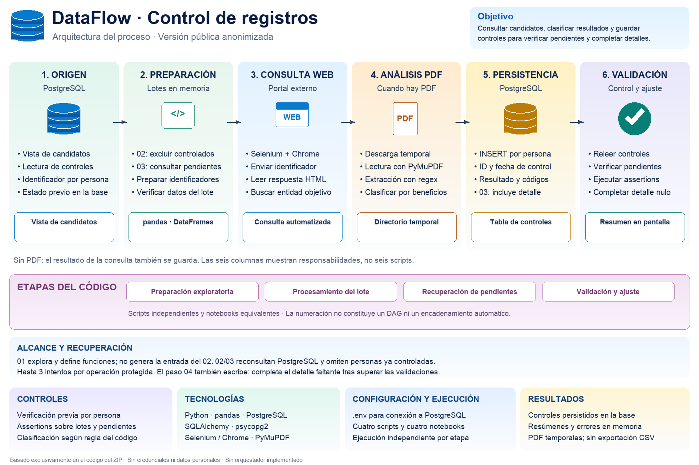

# Hola, soy Paulo Orsini 👋

### 🐍 Python Developer | Automatización de Procesos | Ingeniería de Datos

**Full Stack Development · UX/UI Design · Bases de Datos**

Me especializo en el desarrollo de soluciones con Python, la automatización de procesos y el procesamiento de datos. También desarrollo aplicaciones web y diseño interfaces centradas en la experiencia del usuario.

## 🛠️ Tecnologías y herramientas

  
  
  
  
  

**Lenguajes:** Python · JavaScript · TypeScript · Java · SQL · HTML · CSS

**Backend y automatización:** Python · FastAPI · Spring Boot · APIs REST · Web Scraping

**Frontend:** React · Next.js · Tailwind CSS · Bootstrap

**Datos:** PostgreSQL · MySQL · SQL Server · Pandas

**Diseño UX/UI:** Figma · Design Systems · Responsive Design

**Herramientas:** Git · GitHub · Docker · VS Code - Figma

## 🚀 Proyectos destacados

### 🐍 1. DataFlow ETL Pipeline | Data Engineering

Proyecto de procesamiento y transformación de datos con Python, orientado a la automatización de tareas y la organización de información.

### 🏗️ Arquitectura y flujo del Data Pipeline

📐 [Ver arquitectura completa](Arquitectura%20ETL%20Medallion%20con%20Airflow.png)

🔄 [Ver diagrama de flujo completo](Diagrama%20DataFlow%20ETL%20en%20Airflow.png)

🔒 Repositorio privado.

### 🔎 2. Web Scraping y Automatización con Python

Proyecto de automatización de procesos mediante Python, orientado a la extracción, procesamiento y organización de información desde plataformas web.

Incluye técnicas de web scraping, tratamiento de datos y generación de resultados estructurados.

#### 🏗️ Arquitectura y flujo de automatización

📐 [Ver arquitectura completa](arquitectura_publica.png)

🔄 [Ver diagrama de flujo completo](flujo_publico.png)

🔒 Repositorio privado.

### 🛒 3. DeporShop | E-commerce Full Stack
Aplicación de comercio electrónico con backend en Java y Spring Boot, frontend en React y TypeScript, y rediseño UX/UI propio desarrollado en Figma.

- Diseño responsive para desktop, tablet y mobile.
- Autenticación JWT, carrito de compras y gestión de pedidos.
- Design System y componentes reutilizables.

🔗 [Ver repositorio](https://github.com/MercuryAR/deporshop-ecommerce) · [Demo en vivo](https://deporshop-frontend.onrender.com/)

### 🎨 4. Ollas y Esquinas | Desarrollo Web y UX/UI
Proyecto de desarrollo web con diseño de interfaz y organización visual de componentes.

🔗 [Ver repositorio](https://github.com/MercuryAR/unpilar-efa-ollas-y-esquinas)

## 📫 Contacto y perfiles profesionales

- 💼 [LinkedIn](https://www.linkedin.com/in/paulo-orsini-60206669/)
- 💻 [GitHub](https://github.com/MercuryAR)
